# Trigger a Microsoft Fabric pipeline whenever a new row is inserted into Azure SQL

*CDC, Eventstream, and Activator, step by step: a guide to getting it right the first time*

By Franck Mercier, November 2026

An order is recorded in your Azure SQL database and, a few seconds later, a Fabric pipeline processes it automatically, without scheduling or polling. That is exactly what you can achieve by combining three building blocks of Microsoft Fabric Real-Time Intelligence: change data capture (CDC) on the SQL side, an Eventstream that turns each change into an event, and an Activator rule that starts the pipeline.

I built this chain end to end and encountered a few pitfalls that are not obvious from reading the documentation. This guide incorporates all of them: if you follow the steps in order, using the specified values, the solution should work on your first attempt. A troubleshooting section at the end of the article lists the exact error messages I encountered and their fixes.

## 1. What you will build

The scenario is deliberately simple: a table named `dbo.Commandes` receives orders. For each new order, and only for inserts, a Fabric pipeline receives the order ID, amount, and email address, then calls a stored procedure that writes a log entry. That log entry is tangible proof that the entire chain works.

The event follows this path:

1. An application executes an INSERT into `dbo.Commandes`.
2. Azure SQL CDC records the new row in its change table.
3. The Eventstream Azure SQL DB (CDC) connector reads the change and publishes it as a JSON event in Debezium format.
4. The Eventstream forwards the event to an Activator destination.
5. The Activator rule checks that the event is an insert (the op field equals c) and starts the `PL_TraiterCommande` pipeline with three parameters.
6. The pipeline calls the `dbo.usp_TraiterCommande` procedure, which writes to `dbo.JournalTraitement`.

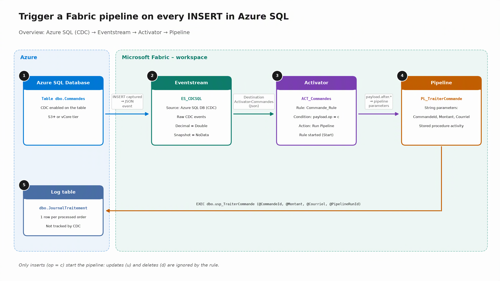

<!--  -->

To avoid any ambiguity, I recommend reusing exactly the names below for your first attempt. The scripts and expressions in this article refer to them. The original French object and column names are retained so that the examples also match the screenshots.

| Item | Name used in this article |
|---|---|
| Azure SQL logical server | `<your-server>.database.windows.net` |
| Database | `<your-database>` |
| Table monitored by CDC | `dbo.Commandes` |
| Log table (proof of execution) | `dbo.JournalTraitement` |
| Stored procedure | `dbo.usp_TraiterCommande` |
| Fabric pipeline | `PL_TraiterCommande` |
| Eventstream | `ES_CDCSQL` |
| Activator destination in the Eventstream | `Activator-Commandes` |
| Activator item | `ACT_Commandes` |
| Activator rule | `Commande_Rule` |

## 2. Prerequisites

Check each of these points before you start. Three of them—service tier, SQL authentication, and network access—cause most failures.

| Prerequisite | Details |
|---|---|
| Fabric workspace | On a Fabric capacity (or trial capacity), with the Contributor role or higher. The pipeline, Eventstream, and Activator will be created in this workspace. |
| Azure SQL service tier | Standard S3 (100 DTUs) or higher, or any vCore tier. CDC is not supported on Free, Basic, or Standard S0, S1, and S2, or in an elastic pool with fewer than 100 eDTUs or fewer than 1 vCore. |
| SQL authentication | The Eventstream CDC connector accepts only Basic authentication (SQL username and password). The server's “Microsoft Entra-only authentication” option must therefore be disabled. |
| Network access | The database must be reachable from Fabric. For a demo: enable public access and allow Azure services. In production: use virtual network injection for the Eventstream connector. |
| Database permissions | An account that belongs to db_owner to enable CDC and create the objects. |
| Mirroring | Fabric mirroring must not be enabled on this database (the CDC connector documentation explicitly requires this). |

## 3. Step 1: check the database service tier

Open your database in the Azure portal, then open Query editor and run:

```sql
SELECT DATABASEPROPERTYEX(DB_NAME(), 'Edition')          AS Edition,
       DATABASEPROPERTYEX(DB_NAME(), 'ServiceObjective') AS ServiceObjective;
```

If the result is Basic, S0, S1, or S2, upgrade the tier before proceeding: in the database, open Settings > Compute + storage and choose Standard S3 or a vCore tier (General Purpose serverless works well for a demo). From the command line:

```bash
az sql db update -g <your-resource-group> -s <your-server> -n <your-database> --service-objective S3
```

The operation takes a few minutes, and the database stays online. If you skip this step, enabling CDC fails with this message:

> Could not update the metadata that indicates database ... is enabled for Change Data Capture. ... The error returned was 22871: 'Change Data Capture is not supported on Free, Basic or Standard tier Single Database (S0,S1,S2) and Database in Elastic pool with max eDTUs < 100 or max vCore < 1. Please upgrade to a higher Service Objective.'

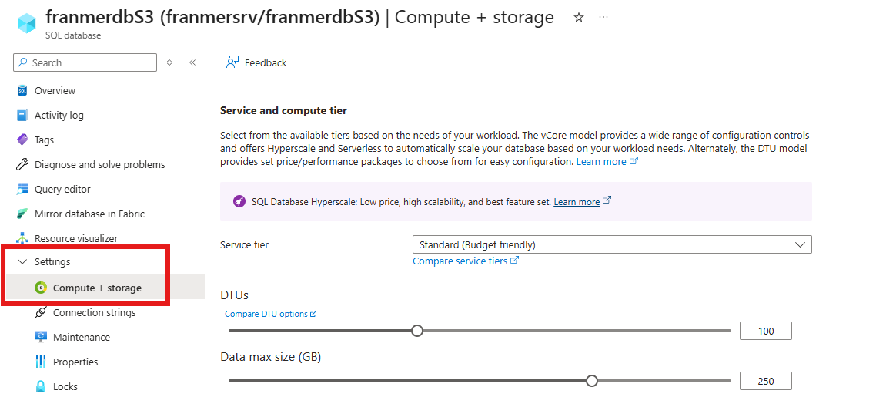

## 4. Step 2: prepare networking and authentication

In the Azure portal, open the logical server (not the database):

1. Settings > Microsoft Entra ID: make sure “Support only Microsoft Entra authentication for this server” is unchecked. The CDC connector needs a SQL user.
2. Security > Networking: set Public network access to Selected networks and check “Allow Azure services and resources to access this server.” Save.
3. Note the full server name (`<your-server>.database.windows.net`), the database name, and the SQL username and password you will use in the Eventstream. For a demo, the server's SQL administrator account is suitable. In production, use a dedicated account.

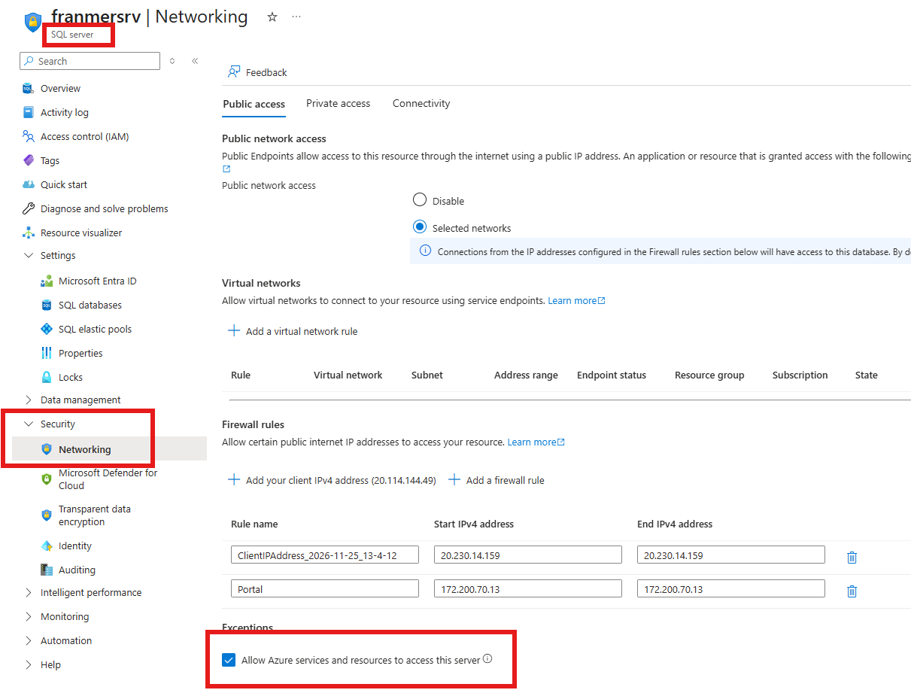

<!--  -->

## 5. Step 3: create the SQL objects

While connected to your database (through the portal Query editor, SSMS, or VS Code), run the complete script below. It creates the monitored table, the log table, and the procedure called by the pipeline.

```sql
-- 1. Source table, monitored by CDC
DROP TABLE IF EXISTS dbo.Commandes;
GO
CREATE TABLE dbo.Commandes (
    CommandeId    INT IDENTITY(1,1) NOT NULL CONSTRAINT PK_Commandes PRIMARY KEY,
    ClientId      INT               NOT NULL,
    NomClient     NVARCHAR(100)     NOT NULL,
    Courriel      NVARCHAR(200)     NULL,
    Produit       NVARCHAR(100)     NOT NULL,
    Quantite      INT               NOT NULL CONSTRAINT CK_Commandes_Quantite CHECK (Quantite > 0),
    PrixUnitaire  DECIMAL(10,2)     NOT NULL,
    Montant       DECIMAL(12,2)     NOT NULL,   -- regular column, NOT a computed column
    Statut        NVARCHAR(20)      NOT NULL CONSTRAINT DF_Commandes_Statut DEFAULT N'Nouvelle',
    Ville         NVARCHAR(50)      NULL,
    DateCommande  DATETIME2(3)      NOT NULL CONSTRAINT DF_Commandes_Date DEFAULT SYSUTCDATETIME()
);
GO

-- 2. Log table, populated by the pipeline (NOT monitored by CDC)
DROP TABLE IF EXISTS dbo.JournalTraitement;
GO
CREATE TABLE dbo.JournalTraitement (
    JournalId      INT IDENTITY(1,1) NOT NULL CONSTRAINT PK_JournalTraitement PRIMARY KEY,
    CommandeId     INT               NOT NULL,
    Montant        NVARCHAR(50)      NULL,
    Courriel       NVARCHAR(200)     NULL,
    PipelineRunId  NVARCHAR(100)     NULL,
    DateTraitement DATETIME2(3)      NOT NULL CONSTRAINT DF_Journal_Date DEFAULT SYSUTCDATETIME()
);
GO

-- 3. Procedure called by the pipeline
CREATE OR ALTER PROCEDURE dbo.usp_TraiterCommande
    @CommandeId    INT,
    @Montant       NVARCHAR(50),
    @Courriel      NVARCHAR(200),
    @PipelineRunId NVARCHAR(100)
AS
BEGIN
    SET NOCOUNT ON;
    INSERT INTO dbo.JournalTraitement (CommandeId, Montant, Courriel, PipelineRunId)
    VALUES (@CommandeId, @Montant, @Courriel, @PipelineRunId);
END;
GO
```

Two design choices matter here. First, Montant is a regular column populated by the INSERT. SQL Server CDC does not capture the values of computed columns, even persisted ones: they would always arrive as NULL in the event. Second, the log table is not monitored by CDC, preventing a pipeline write from triggering the pipeline again.

## 6. Step 4: enable CDC on the database and table

```sql
-- Enable CDC on the database
EXEC sys.sp_cdc_enable_db;
GO

-- Enable CDC on the dbo.Commandes table only
EXEC sys.sp_cdc_enable_table
     @source_schema = N'dbo',
     @source_name   = N'Commandes',
     @role_name     = NULL;
GO

-- Verification
SELECT name, is_cdc_enabled    FROM sys.databases WHERE name = DB_NAME();
SELECT name, is_tracked_by_cdc FROM sys.tables    WHERE name IN (N'Commandes', N'JournalTraitement');
```

Expected result: `is_cdc_enabled` is 1 for the database, and `is_tracked_by_cdc` is 1 for Commandes and 0 for JournalTraitement.

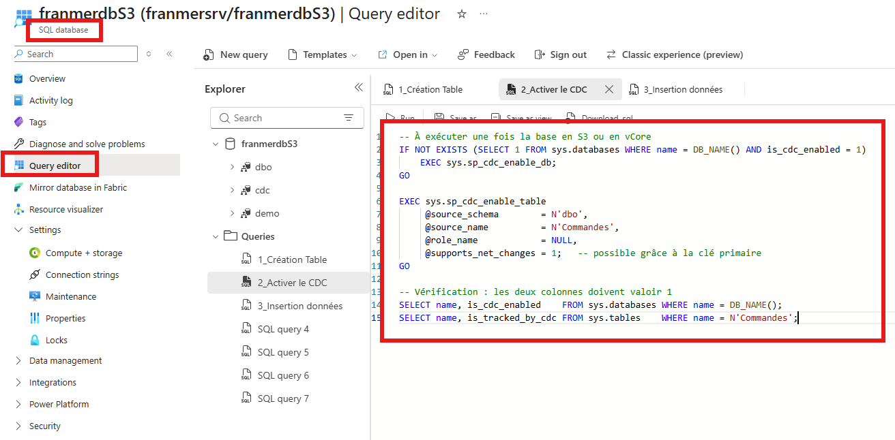

<!--  -->

## 7. Step 5: create the Fabric pipeline

The pipeline must exist before the Activator rule, because the rule selects it and reads its parameters.

### 7.1 Create the pipeline and its parameters

1. In your Fabric workspace, select + New item, then Pipeline. Name it `PL_TraiterCommande`.
2. Click an empty area of the canvas, open the Parameters tab at the bottom of the screen, and add three parameters using + New:

   | Name (case-sensitive) | Type | Default value |
   |---|---|---|
   | CommandeId | String | (empty) |
   | Montant | String | (empty) |
   | Courriel | String | (empty) |

Why use String for everything? It is the most robust choice: Activator sends text values, avoiding any type ambiguity between Activator and the pipeline. The conversion to an integer happens later, when the stored procedure is called.

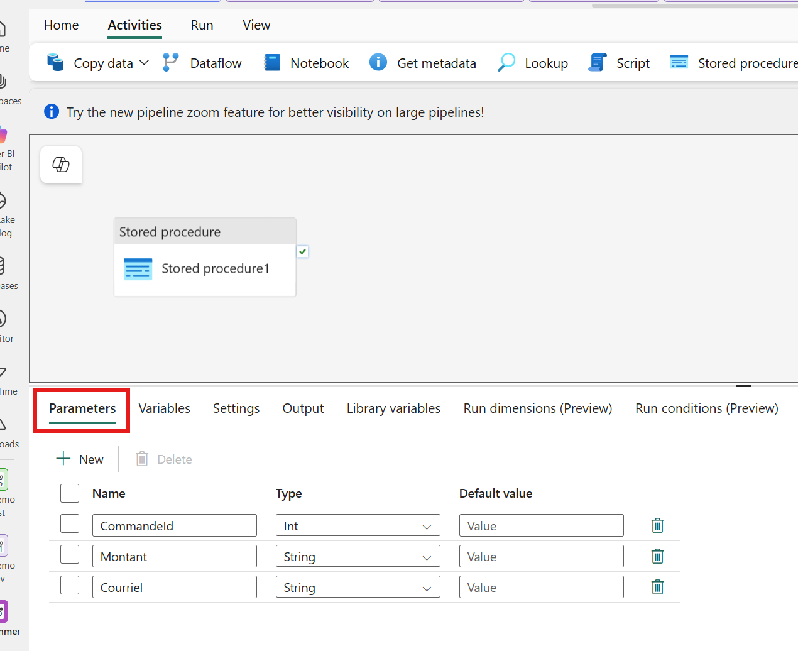

<!--  -->

### 7.2 Add the Stored procedure activity

1. In the Activities tab, add a Stored procedure activity to the canvas.
2. In its Settings tab, choose the connection to your Azure SQL database (or create one using the server and database noted in step 2).
3. Under Stored procedure name, select `dbo.usp_TraiterCommande`.
4. Under Stored procedure parameters, click Import to retrieve the procedure's four parameters (otherwise, add them using + New).
5. For each parameter, click the Value field, choose Add dynamic content, paste the expression from the table below, and confirm with OK.

   | Name | Type | Value (dynamic content) |
   |---|---|---|
   | CommandeId | Int32 | `@pipeline().parameters.CommandeId` |
   | Montant | String | `@pipeline().parameters.Montant` |
   | Courriel | String | `@pipeline().parameters.Courriel` |
   | PipelineRunId | String | `@pipeline().RunId` |

6. Save the pipeline (Save).

Why use a stored procedure rather than a Script activity? In the Script activity editor, the @ character in a T-SQL variable (for example, `@CommandeId`) is interpreted as the start of a Fabric expression. This can produce confusing errors such as “Must declare the scalar variable "@CommandeId".” The Stored procedure activity avoids this pitfall entirely and passes the values as actual SQL parameters, which also protects against SQL injection.

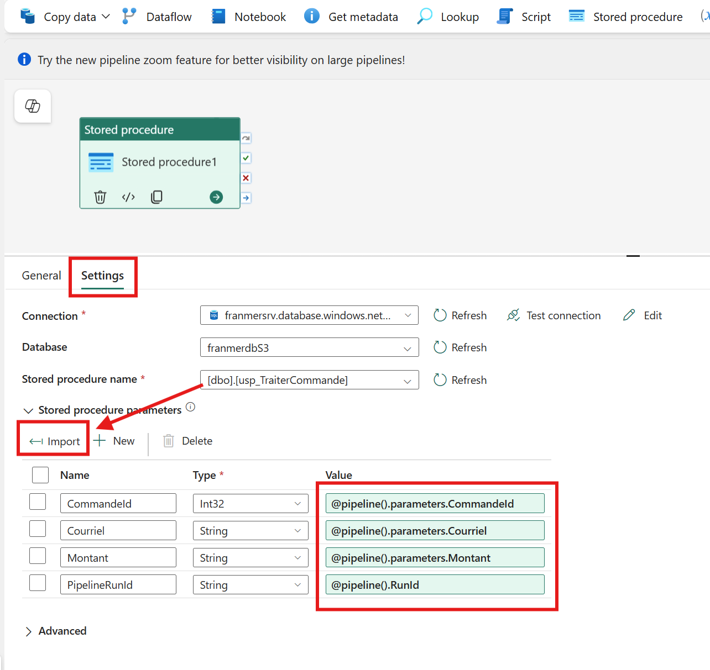

### 7.3 Test the pipeline on its own (recommended)

Before connecting Activator, validate the pipeline in isolation: click Run, enter CommandeId = 1, Montant = 10.0, and Courriel = test@exemple.com, then start the run. Next, check the database:

```sql
SELECT * FROM dbo.JournalTraitement ORDER BY JournalId DESC;
```

A row should appear. If this test fails, fix the pipeline now: diagnosing a standalone pipeline is much easier than diagnosing the entire chain. You can then clear the log table using `DELETE FROM dbo.JournalTraitement;`.

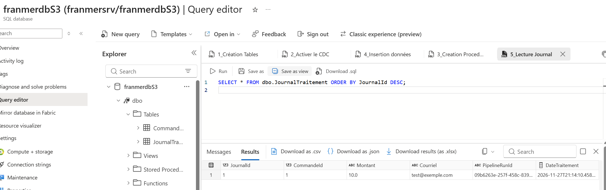

## 8. Step 6: create the Eventstream and CDC source

### 8.1 Create the Eventstream

In the workspace, select + New item, then Eventstream. Name it `ES_CDCSQL` and create it.

### 8.2 Add the Azure SQL DB (CDC) source

1. Select Connect data sources (or Add source > Connect data sources in the ribbon).
2. Find the Azure SQL DB (CDC) tile and click Connect.
3. Select New connection and fill in:

   | Field | Value |
   |---|---|
   | Server | `<your-server>.database.windows.net` |
   | Database | `<your-database>` |
   | Connection name | A descriptive name, for example `cnx-sql-cdc-commandes` |
   | Authentication kind | Basic (the only option supported by this connector) |
   | Username / Password | The SQL username and password noted in step 2 |

4. Click Connect.

### 8.3 Choose the table and advanced settings

1. Select Enter table name(s) and enter `dbo.Commandes`. Do not use All tables: you would also capture the log table.
2. Expand Advanced settings and configure these two options. Leave the others at their default values.

   | Advanced setting | Value to choose | Why |
   |---|---|---|
   | Decimal handling mode | Double | In Precise mode (the default), DECIMAL columns are encoded as bytes in the event and become unreadable to Activator and the pipeline. |
   | Snapshot mode | NoData | Only inserts made after the connector starts are sent. With Initial, all existing rows would be emitted at startup. |

3. Keep the suggested source name (for example, `azure-sql-db`) and click Next.

### 8.4 Schema handling: choose Raw CDC events

On the Schema handling page, select Raw CDC events and leave “Register raw CDC events schema to Event schema set” unchecked. Click Next, then Add on the Review + connect page.

Do not choose “Analytics-ready events & auto-updated schema” (DeltaFlow), even if it is marked Recommended. According to the documentation, only Eventhouse, custom endpoint, and derived stream destinations currently work with a schema-enabled Eventstream. Activator is not among them. DeltaFlow is excellent for feeding an Eventhouse, but that is not our goal here.

## 9. Step 7: add the Activator destination and publish

1. Still in Edit mode, click the + to the right of the `ES_CDCSQL-stream` stream node and choose Activator.
2. Fill in the destination pane:

   | Field | Value |
   |---|---|
   | Destination name | `Activator-Commandes` |
   | Workspace | Your workspace |
   | Activator | Create new, then name it `ACT_Commandes` |
   | Input data format | Json |

3. Click Save, then Publish in the upper-right corner.

The destination is connected directly to the stream: no transformation operator is needed, because inserts will be filtered in the Activator rule. The pane also displays a warning: Activator accepts events up to 256 KB. A table such as `dbo.Commandes` is well below that limit.

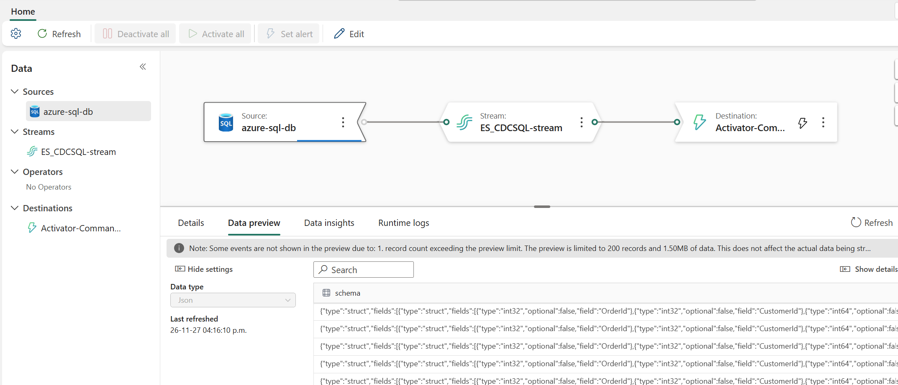

## 10. Step 8: send the first event and understand its format

This step is essential. Activator only offers an event's properties (`payload.op`, `payload.after.CommandeId`, etc.) after receiving at least one event. Insert a first order to seed the stream:

```sql
INSERT INTO dbo.Commandes (ClientId, NomClient, Courriel, Produit, Quantite, PrixUnitaire, Montant, Ville)
OUTPUT inserted.CommandeId
VALUES (100, N'Client amorce', N'vous@exemple.com', N'Formation Power BI', 2, 450.00, 900.00, N'Montréal');
```

Typically, allow a few seconds to a minute: CDC reads the transaction log at regular intervals, then the connector publishes the event. In the Eventstream, switch to Live view, select the `ES_CDCSQL-stream` node, and open the Data preview tab.

You will see an event in Debezium format. Here is a simplified version (your values will differ):

```json
{
  "schema": { "...": "technical description of the fields" },
  "payload": {
    "before": null,
    "after": {
      "CommandeId": 1,
      "ClientId": 100,
      "NomClient": "Client amorce",
      "Courriel": "vous@exemple.com",
      "Produit": "Formation Power BI",
      "Quantite": 2,
      "PrixUnitaire": 450.0,
      "Montant": 900.0,
      "Statut": "Nouvelle",
      "Ville": "Montréal",
      "DateCommande": 1795705600000
    },
    "source": { "connector": "sqlserver", "schema": "dbo", "table": "Commandes" },
    "op": "c",
    "ts_ms": 1795705601234
  }
}
```

Two fields matter to us. `payload.after` contains the row's columns after the change. `payload.op` identifies the operation type:

| `payload.op` value | Meaning | Should it start the pipeline? |
|---|---|---|
| c | Insert (create) | Yes |
| u | Update | No |
| d | Delete; `payload.after` is empty in this case | No |
| r | Read during the initial snapshot | No |

You can also confirm on the SQL side that CDC captured the row:

```sql
SELECT TOP (10) __$start_lsn, __$operation, CommandeId, NomClient, Montant
FROM cdc.dbo_Commandes_CT
ORDER BY __$start_lsn DESC;   -- __$operation = 2 for an insert
```

> 📸 **SCREENSHOT 12: Eventstream Data preview showing `payload.op` = "c" and `payload.after`**

<!--  -->

## 11. Step 9: create the Activator rule

### 11.1 Open the rule creation pane

In the Eventstream's Live view, select the alert icon (lightning bolt) on the `Activator-Commandes` destination. In the Rules pane, click Add rule. You can also open the `ACT_Commandes` item from the workspace and create the rule on the `ES_CDCSQL-stream` stream.

### 11.2 Define the condition: inserts only

1. Name the rule `Commande_Rule`.
2. Under Condition > Condition 1, configure:
   - Operation: Is equal to (Text state group), instead of On every value.
   - Column: `payload.op`.
   - Value: c, typed directly (this is a fixed value).
   - Default type: leave None.

Do not use Text change > Changes to: that condition triggers only when the value changes. Two consecutive inserts (c followed by c) would start the pipeline only once.

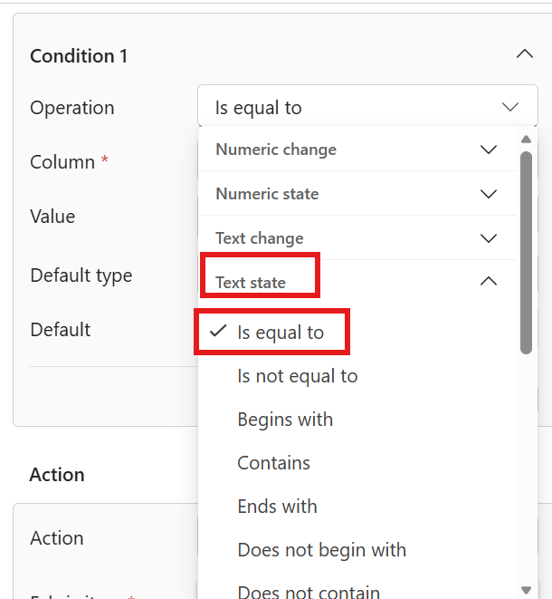

> 💡 **Why `payload.op` = `c`?**
>
> Each event emitted by the CDC connector describes a change to the table: `payload.before` contains the row before the change, `payload.after` contains the row after the change, and `payload.op` identifies the SQL **operation type** that produced it: `c` for an insert (*create*), `u` for an update, `d` for a delete, and `r` for a read during the initial snapshot (see the table in section 10).
>
> Without a condition, the rule would start the pipeline for **every** event in the stream: an updated or deleted order would also trigger processing. By filtering on `payload.op` = `c`, only an `INSERT` starts the pipeline. It is also the only case where `payload.after` contains a complete new order, ensuring that `CommandeId`, `Montant`, and `Courriel` are populated.
>
> On the SQL side, this is the same information as the `__$operation` column in the `cdc.dbo_Commandes_CT` table, where the value `2` corresponds to an insert.

### 11.3 Define the action: start the pipeline with the correct parameters

1. Under Action > Select action, choose Run Pipeline.
2. Under Fabric item, select `PL_TraiterCommande`.
3. Click Add parameter three times and fill in:

   | Name (must match the pipeline, including case) | Type | Value (selected using the tag icon) |
   |---|---|---|
   | CommandeId | String | `payload.after.CommandeId` |
   | Montant | String | `payload.after.Montant` |
   | Courriel | String | `payload.after.Courriel` |

This is the most important point. The value must be selected, not typed. Click the tag-shaped icon to the right of the Value field, then choose the property from the list. It appears as a pill (token). If you type `@CommandeId`, Activator sends the literal text “`@CommandeId`” to the pipeline, which then fails. Also make sure no characters (a leftover @ or a space) remain before or after the token.

4. Under Save location, keep the `ACT_Commandes` Activator, then click Create.

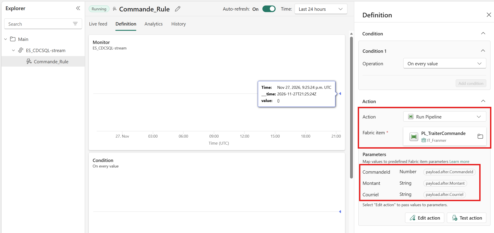

### 11.4 Start the rule

Open the rule in Activator and check the ribbon: if Start is enabled and Stop is grayed out, the rule is stopped. Click Start. Check this after every rule modification: in practice, an edited rule may end up stopped.

<!--  -->

## 12. Step 10: test end to end

### 12.1 A single insert

```sql
INSERT INTO dbo.Commandes (ClientId, NomClient, Courriel, Produit, Quantite, PrixUnitaire, Montant, Ville)
OUTPUT inserted.CommandeId, inserted.Montant
VALUES (301, N'Test Activator', N'vous@exemple.com', N'Licence Fabric F64', 1, 8500.00, 8500.00, N'Québec');
```

Note the CommandeId returned by OUTPUT: you will find it in the pipeline's input parameters.

### 12.2 A small series of spaced-out inserts

```sql
DECLARE @i INT = 1, @nb INT = 3;          -- 1 insert = 1 pipeline run
DECLARE @qte INT, @prix DECIMAL(10,2), @p INT, @v INT;

WHILE @i <= @nb
BEGIN
    -- Random values calculated BEFORE the INSERT (avoids NULLs from CHOOSE + NEWID)
    SET @qte  = 1 + ABS(CHECKSUM(NEWID())) % 10;
    SET @prix = CAST(100 + ABS(CHECKSUM(NEWID())) % 900 AS DECIMAL(10,2));
    SET @p    = 1 + ABS(CHECKSUM(NEWID())) % 3;
    SET @v    = 1 + ABS(CHECKSUM(NEWID())) % 4;

    INSERT INTO dbo.Commandes (ClientId, NomClient, Courriel, Produit, Quantite, PrixUnitaire, Montant, Ville)
    OUTPUT inserted.CommandeId, inserted.Produit, inserted.Montant
    VALUES (400 + @i,
            CONCAT(N'Client démo ', @i),
            N'vous@exemple.com',
            CHOOSE(@p, N'Licence Fabric F64', N'Formation Power BI', N'Capteurs IoT'),
            @qte, @prix, @qte * @prix,
            CHOOSE(@v, N'Montréal', N'Québec', N'Gatineau', N'Laval'));

    WAITFOR DELAY '00:00:10';             -- 10 seconds between inserts
    SET @i += 1;
END;
```

### 12.3 The negative test: an update must not trigger anything

```sql
UPDATE dbo.Commandes SET Statut = N'Expédiée' WHERE CommandeId = 1;
```

The event appears in the Eventstream with `payload.op` equal to u, but the rule does not activate and no pipeline run starts.

### 12.4 Where to verify

| Stage | Where to look | What you should see |
|---|---|---|
| Database | Query against `cdc.dbo_Commandes_CT` | One row with `__$operation` = 2 for each inserted order |
| Eventstream | Data preview of the `ES_CDCSQL-stream` stream | One event per order, with `payload.op` = c |
| Activator | Activation history of `Commande_Rule` | One activation per insert, none for the update |
| Pipeline | Fabric Monitoring hub | One successful `PL_TraiterCommande` run per insert; in its input parameters, CommandeId contains an actual number (for example, 2), never the text “`@CommandeId`” |
| Log | Query below | One log entry for each order inserted after the rule started |

```sql
SELECT c.CommandeId, c.Montant, j.PipelineRunId, j.DateTraitement
FROM dbo.Commandes AS c
LEFT JOIN dbo.JournalTraitement AS j ON j.CommandeId = c.CommandeId
ORDER BY c.CommandeId DESC;
```

The seed order from step 8 has no log entry: it was inserted before the rule was created. This is expected.

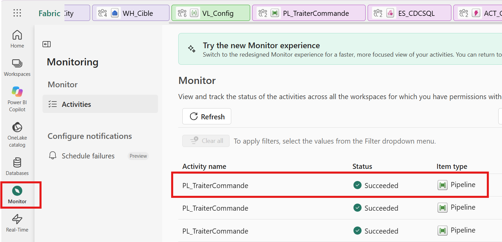

## 13. Key settings summary

| Where | Setting | Value |
|---|---|---|
| Azure SQL | Service tier | S3 or higher, or vCore |
| Azure SQL | Montant column | Regular column (not computed) |
| CDC source | Authentication kind | Basic |
| CDC source | Tables | `dbo.Commandes` |
| CDC source | Decimal handling mode | Double |
| CDC source | Snapshot mode | NoData |
| CDC source | Schema handling | Raw CDC events, schema registration unchecked |
| Destination | Type and format | Activator, Json, connected directly to the stream |
| Rule | Condition | `payload.op` Is equal to c |
| Rule | Action | Run Pipeline, `PL_TraiterCommande` |
| Rule | Parameter values | Selected using the tag icon, String type |
| Rule | State | Started (Start) |
| Pipeline | Parameters | CommandeId, Montant, and Courriel as String |
| Pipeline | Activity | Stored procedure, CommandeId converted to Int32 |

## 14. Troubleshooting: the errors I encountered

| Symptom or message | Cause | Fix |
|---|---|---|
| Error 22871: “Change Data Capture is not supported on Free, Basic or Standard tier Single Database (S0,S1,S2)...” | Service tier too low | Upgrade to S3 or vCore (step 1), then rerun the enablement script |
| The CDC source connection fails | Database unreachable, or SQL authentication disabled | Allow Azure services access and disable “Microsoft Entra-only authentication” (step 2) |
| No events in Data preview | CDC not enabled on the table, incorrect table name, or no inserts since startup (NoData mode) | Check `is_tracked_by_cdc` and the table list, then insert a new row and wait up to a minute |
| Montant is always null in the event | Montant is a computed column | CDC does not capture computed column values: use a regular column |
| Montant appears as an unreadable encoded string | Decimal handling mode left at Precise | Set it to Double in the source's advanced settings |
| Cannot add or use the Activator destination | Schema associated with the Eventstream (DeltaFlow or schema registration checked) | Recreate the source using Raw CDC events with registration unchecked |
| Pipeline fails: “Must declare the scalar variable "@CommandeId"” | The text “`@CommandeId`” was passed instead of the value, or a Script activity interprets the @ | Select the value using the tag icon in the rule; use a Stored procedure activity |
| Pipeline fails: “`@CommandeId` is not a valid value for Int32” | The parameter value was typed in the rule, or a leftover @ precedes the token | Clear the Value field and reselect the property using the tag icon |
| The pipeline also starts for updates or existing rows | The rule triggers on every event | Add the condition `payload.op` Is equal to c; use Snapshot mode = NoData |
| Rerun keeps failing with the same error | Rerun reuses exactly the same input parameters | Test with a new insert after applying the fix |
| The rule no longer triggers after an edit | Rule stopped | Click Start in the Activator ribbon |

## 15. Before moving to production

Each insert triggers a pipeline run. This is ideal for per-record processing (notifications, API calls, or order enrichment), but at high volumes it multiplies runs and capacity consumption. In that case, narrow the rule condition (for example, by requiring a minimum amount), or have the pipeline process all pending rows in one batch rather than just one.

Design the processing to be idempotent: replaying it for the same order must not create a duplicate. A uniqueness constraint on `JournalTraitement.CommandeId`, or a MERGE in the procedure, is sufficient in this scenario.

From a security standpoint, the CDC connector currently requires Basic authentication. Use a dedicated SQL account with a strong password stored in a vault and rotated regularly, and prefer the connector's virtual network injection over public access. If Microsoft Entra authentication is a requirement, keep an eye on Change Event Streaming (CES), in preview for SQL Server 2025 and Azure SQL Database: the database itself pushes its changes to an Eventstream custom endpoint using Microsoft Entra, a SAS token, or a SAS key.

Finally, remember that CDC sets a minimum cost floor (S3 or vCore), and Fabric mirroring must not be enabled on a database used as an Eventstream CDC source.

## 16. Cleanup after the demo

Before lowering the database tier below S3, disable CDC:

```sql
EXEC sys.sp_cdc_disable_table @source_schema = N'dbo', @source_name = N'Commandes', @capture_instance = 'all';
EXEC sys.sp_cdc_disable_db;
```

Then, in Fabric, delete the rule, the `ACT_Commandes` item, the `ES_CDCSQL` Eventstream, and the `PL_TraiterCommande` pipeline, and lower the database service tier if desired.

## 17. References

- [Add an Azure SQL Database CDC source to an Eventstream](https://learn.microsoft.com/en-us/fabric/real-time-intelligence/event-streams/add-source-azure-sql-database-change-data-capture)
- [Add an Activator destination to an Eventstream](https://learn.microsoft.com/en-us/fabric/real-time-intelligence/event-streams/add-destination-activator)
- [Create a rule in Fabric Activator](https://learn.microsoft.com/en-us/fabric/real-time-intelligence/data-activator/activator-create-activators)
- [Configure Activator rule actions](https://learn.microsoft.com/en-us/fabric/real-time-intelligence/data-activator/rule-actions)
- [Activator rules overview](https://learn.microsoft.com/en-us/fabric/real-time-intelligence/data-activator/activator-rules-overview)
- [Stream SQL change events (CES) to an Eventstream](https://learn.microsoft.com/en-us/fabric/real-time-intelligence/event-streams/stream-sql-change-events-to-eventstream)
